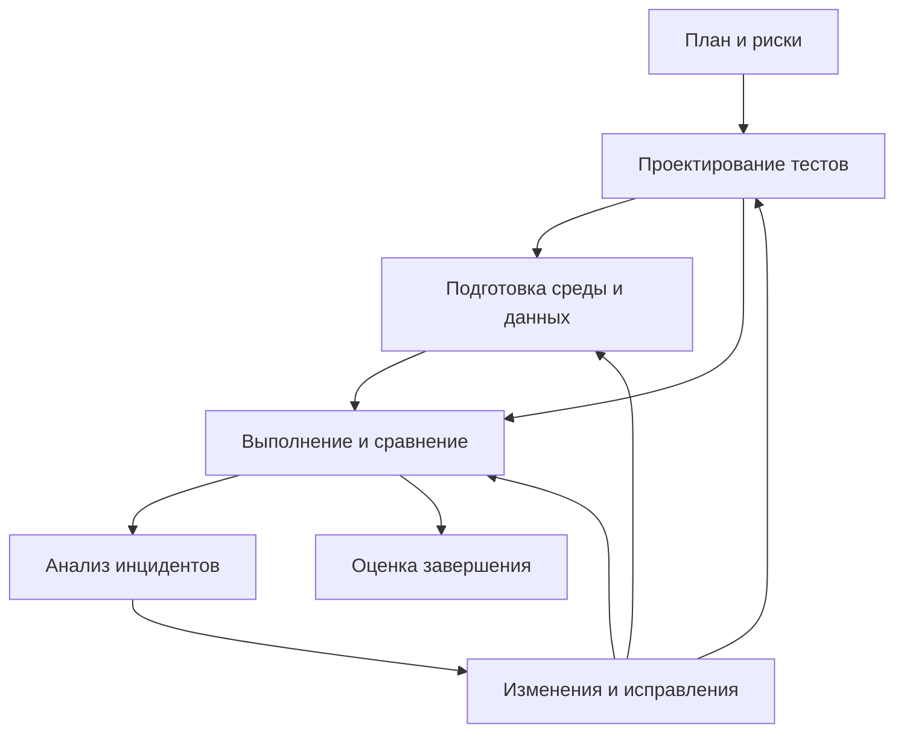

# Конспект серии ISO/IEC/IEEE 29119 «Тестирование программного обеспечения»

## Содержание

1. [Карта серии и правила чтения](#1-карта-серии-и-правила-чтения)
2. [Часть 1: понятия и определения](#2-часть-1-понятия-и-определения)
3. [Часть 2: процессы тестирования](#3-часть-2-процессы-тестирования)
4. [Часть 3: документация тестирования](#4-часть-3-документация-тестирования)
5. [Часть 4: техники проектирования тестов](#5-часть-4-техники-проектирования-тестов)
6. [Часть 5: тестирование по ключевым словам](#6-часть-5-тестирование-по-ключевым-словам)
7. [Часть 6: применение в Agile](#7-часть-6-применение-в-agile)
8. [Часть 11: тестирование систем с ИИ](#8-часть-11-тестирование-систем-с-ии)
9. [Часть 13: тестирование биометрических систем](#9-часть-13-тестирование-биометрических-систем)
10. [Как части работают вместе: учебный пример](#10-как-части-работают-вместе-учебный-пример)
11. [Шпаргалка для повторения](#11-шпаргалка-для-повторения)
12. [Указатель документов](#12-указатель-документов)

## 1. Карта серии и правила чтения

### 1.1. За что отвечает каждая часть

| Документ | Редакция в конспекте | Назначение | Новая редакция |
|---|---|---|---|
| ISO/IEC/IEEE 29119-1, *Concepts and definitions* | 2013 | Общий язык: что такое тестирование, зачем оно нужно и как связано с жизненным циклом | 2022, *General concepts* |
| ISO/IEC/IEEE 29119-2, *Test processes* | 2013 | Организация, управление и выполнение тестирования | 2021 |
| ISO/IEC/IEEE 29119-3, *Test documentation* | 2013 | Содержание планов, спецификаций, журналов и отчётов | 2021 |
| ISO/IEC/IEEE 29119-4, *Test techniques* | 2015 | Получение тестовых условий, элементов покрытия и тестовых случаев | 2021 |
| ISO/IEC/IEEE 29119-5, *Keyword-Driven Testing* | 2016 | Представление тестов через ключевые слова и требования к поддерживающим средствам | 2024 |
| ISO/IEC TR 29119-6, руководство по Agile | 2021 | Сопоставление гибких практик с процессами и документацией серии | — |
| ISO/IEC TR 29119-11, руководство по тестированию ИИ | 2020 | Особенности ИИ, проблема ожидаемого результата, подходы к проверке | — |
| ISO/IEC TR 29119-13, применение серии в биометрии | 2022 | Совмещение проверки биометрии с систематическим тестированием ПО | — |

**Связь частей:** понятия части 1 используются в процессах части 2; результаты процессов оформляются по части 3; конкретные тесты проектируются с помощью части 4; часть 5 предлагает способ описания и исполнения этих тестов. Части 6, 11 и 13 рассматривают особые контексты применения.

Серия рассчитана на разные размеры организаций, виды ПО и модели разработки. Она не задаёт единственный жизненный цикл и не требует, чтобы вся работа была организована как последовательные стадии водопадной модели.

### 1.2. Требования, рекомендации и соответствие

В нормативных разделах важно различать:

- **shall** — требование, которое необходимо выполнить для заявленного соответствия;
- **should** — рекомендацию;
- **may** — допустимую возможность;
- **informative** — пояснения и примеры; они помогают применять требования, но сами по себе не становятся обязательными.

Часть 1 носит информационный характер. Документы с обозначением **TR — Technical Report** являются техническими отчётами с руководящими материалами, а не дополнительными наборами требований того же типа, что нормативные разделы частей 2–5.

**Tailoring — адаптация** означает выбор применимого состава процессов, документов или требований с учётом контекста. При заявлении адаптированного соответствия решения об исключениях необходимо обосновать, зафиксировать с учётом рисков и согласовать с заинтересованными сторонами. Адаптация не равна произвольному отказу от неудобных требований.

Особенности конкретных частей:

| Часть | Что означает полное соответствие в редакциях 2013–2016 |
|---|---|
| 2 | Выполнение всех требований полного набора процессов. При адаптированном соответствии фиксируется выбранный состав и выполняются требования этого состава |
| 3 | Наличие всего набора предусмотренных информационных элементов. Также можно заявлять соответствие выбранным документам, не заявляя его всей части |
| 4 | Выполнение всех требований **выбранного непустого набора техник и/или соответствующих измерений покрытия**. Использование всех перечисленных техник не требуется |
| 5 | Выполнение всех требований к поддержке тестирования по ключевым словам. Для отдельных компонентов предусмотрено адаптированное соответствие |

Электронная запись, таблица, база данных или объединённый документ могут содержать требуемую информацию. Название документа и число физических файлов сами по себе не определяют соответствие.

### 1.3. Что изменилось в редакциях 2021–2024

Основной текст конспекта описывает редакции 2013–2016. Ключевое изменение новых редакций — **тестовые условия (test conditions) заменены тестовыми моделями (test models)**: пользователи неверно понимали термин «условие» и испытывали трудности при получении тестов.

| Часть | Что изменилось |
|---|---|
| 1 (2022) | Название «General concepts»; убраны не используемые термины; материал компактнее и переупорядочен. Понятие подпроцесса заменено расширенным описанием того, как экземпляры процессов создаются в проекте. Уточнено содержание стратегии. Тестовые случаи выводят из тестовых моделей. Метрики и измерения перенесены из приложения в основной текст. Убрано приложение о жизненных циклах; добавлено приложение с примерами связи характеристик систем разных областей и подходов к тестированию. Разделы 4.2–4.7: планы и стратегии, фреймворки, проектирование и выполнение (включая модель-ориентированное, скриптовое и исследовательское тестирование, регрессионное, автоматизированное, непрерывное, back-to-back, A/B, fuzz), управление проектом, коммуникации, дефекты и инциденты; приложение B — роли |
| 2 (2021) | Процессы: организационный (6), стратегия и планирование (7.2), мониторинг и контроль (7.3), завершение (7.4), проектирование и реализация (8.2), управление средой **и данными** (8.3), выполнение (8.4), отчёты об инцидентах (8.5). Проектирование идёт через тестовые модели. Введены разделы о соответствии (4) и многоуровневой модели (5). Приложения: пример проектирования; соответствие ISO/IEC/IEEE 12207:2017; ISO/IEC 17025:2017; BS 7925-2:1998; тестовые модели |
| 3 (2021) | Организационная стратегия заменена **организационными практиками**; стратегия проекта входит в план; спецификация проектирования заменена **спецификацией тестовой модели**; фактические результаты и результат проверки описаны в одном разделе. Приложение A нормативное (требования, рекомендации, разрешения); приложения B–R — примеры; S — соответствие IEEE 829:2008; T — тестовые модели |
| 4 (2021) | Добавлен раздел соответствия (полное и адаптированное). В спецификационные техники добавлены **Metamorphic testing** (5.2.11) и **Requirements-based testing** (5.2.12) с разделами покрытия. Шаги: создать тестовую модель, определить элементы покрытия, получить тестовые случаи. Добавлены приложения о grey-box техниках (E) и тестовых моделях (H). Исследовательское и модель-ориентированное тестирование не определяются: часть описывает только проектирование тестовых случаев |
| 5 (2024) | Ссылочный подход к KDT; требования к фреймворкам для совместного использования тестов, данных и ключевых слов; требования к средствам автоматизации, проектирования и управления тестами; интерфейсы и общий формат обмена данными; иерархические и «плоские» ключевые слова, навигационные и проверочные слова; начальный список универсальных низкоуровневых слов |

**Источники:** части 1–5, введения и разделы 1–2; часть 3, § 2; части 6, 11 и 13, введения; сведения о новых редакциях — по оглавлениям и аннотациям ISO/IEC/IEEE.

## 2. Часть 1: понятия и определения

### 2.1. Зачем нужно тестирование

Тестирование — совокупность действий для обнаружения и оценки свойств объекта проверки. В него входят планирование, подготовка, выполнение, анализ, отчётность и управление.

Основные цели:

1. Получить информацию о качестве продукта и остаточных рисках.
2. Найти дефекты до передачи продукта пользователям.
3. Снизить риск последствий недостаточного качества.
4. Поддержать решения о доработке, выпуске и изменении процессов разработки.

Тестирование даёт основания для решения, но не гарантирует отсутствие всех дефектов. Исчерпывающая проверка сложного ПО обычно невозможна: слишком много входных данных, состояний, последовательностей действий и сочетаний условий.

Многие способы тестирования опираются на **эвристики**: полезные, но потенциально ошибочные способы построения модели и выбора проверок. Поэтому полнота проверки в рамках одной модели ещё не означает, что модель охватила все существенные свойства системы.

### 2.2. Ошибка человека, дефект и отказ

| Понятие | Смысл | Учебный пример |
|---|---|---|
| Ошибка человека — *error / mistake* | Неверное действие или решение при создании продукта | Разработчик неправильно понял ограничение размера файла |
| Дефект — *defect* | Недостаток созданного рабочего продукта: кода, требований, проекта и т. п. | В проверке используется неверный знак сравнения |
| Отказ — *failure* | Наблюдаемое нарушение требуемого поведения при выполнении | Программа отвергает допустимый файл |

Дефект может долго не проявляться, если не возникли нужные условия. Причина наблюдаемого отклонения может находиться в продукте, требованиях, тесте или среде. Поэтому неудачный тест требует анализа, а не автоматического заключения «ошибка в коде».

### 2.3. Верификация и валидация

| Понятие | Основной вопрос | Что проверяется |
|---|---|---|
| Верификация — *verification* | Выполнены ли заданные требования? | Соответствие рабочего продукта установленным требованиям |
| Валидация — *validation* | Подходит ли продукт для задач пользователей? | Возможность использовать продукт по назначению в нужном контексте |

Статическое и динамическое тестирование могут поддерживать обе цели. Верификация и валидация шире тестирования: в них также могут входить формальные методы, анализ и другие инженерные действия.

### 2.4. Статическое и динамическое тестирование

**Статическое тестирование** выполняется без запуска проверяемого программного кода. Примеры: рецензирование требований, проверка проекта, инспекция кода, анализ согласованности документов, статический анализ исходников.

**Динамическое тестирование** требует выполнения кода. В него входят не только запуск теста, но и проектирование проверок, подготовка среды, сравнение результатов и работа с обнаруженными инцидентами.

Динамическая проверка необходима, но сама по себе недостаточна. Статические проверки позволяют обнаруживать проблемы раньше. Подробные процессы динамического тестирования заданы частью 2; техники части 4 относятся к динамическому тестированию. Подробные техники статических проверок серия в основном связывает с другими стандартами.

### 2.5. Объект, базис, условия, покрытие и тестовый случай

| Термин | Краткое определение |
|---|---|
| **Test item — объект тестирования** | Рабочий продукт, который проверяют: модуль, система, документ, проект, руководство |
| **Test basis — базис тестирования** | Знания, на основании которых выбирают и оценивают проверки: требования, модели, проект, опыт специалистов |
| **Feature set — группа проверяемых свойств** | Логически выделенная часть объекта, которую удобно отдельно анализировать и тестировать |
| **Test condition — тестовое условие** | Проверяемый элемент или событие, выделенное из базиса |
| **Test coverage item — элемент покрытия** | Конкретное свойство или сочетание свойств, которое техника требует охватить тестами |
| **Test case — тестовый случай** | Предусловия, входные данные и действия, ожидаемые результаты для конкретной проверки |
| **Test set — набор тестов** | Группа тестовых случаев для определённой цели |
| **Test procedure — тестовая процедура** | Упорядоченный набор тестовых случаев вместе с подготовительными и завершающими действиями |
| **Expected results — ожидаемые результаты** | Предсказанное наблюдаемое поведение при заданных условиях |
| **Actual results — фактические результаты** | Реально наблюдавшиеся выходы, поведение и изменения состояния |
| **Test result — результат проверки** | Вывод о соответствии фактического результата ожидаемому |
| **Test coverage — покрытие** | Степень охвата выбранного множества элементов покрытия выполненными тестами |
| **Test oracle — тестовый оракул** | Источник информации о том, прошёл ли тест: спецификация, модель, предыдущая версия, эксперт |
| **Test model — тестовая модель** (ред. 2021) | Представление проверяемых аспектов объекта (состояния, правила, потоки), из которого выводят элементы покрытия и тесты |

Тестовое условие и элемент покрытия иногда совпадают, например при разбиении на классы эквивалентности. Для анализа границ условием может быть граница диапазона, а элементами покрытия — значения на ней и рядом с ней.

Один и тот же документ может играть разные роли: требования являются **объектом** при рецензировании требований и **базисом** при проверке реализованной системы.

### 2.6. Уровни, виды и подпроцессы

**Уровень тестирования** связан с масштабом и положением объекта в разработке: компонентное, интеграционное, системное, приёмочное тестирование.

**Вид тестирования** связан с целью или свойством качества: функциональное, производительности, безопасности, удобства использования и т. д.

**Подпроцесс тестирования** — применение общего процесса к конкретной области. Он может соответствовать уровню, виду или их сочетанию. Например, системное тестирование включает функциональные проверки и проверки производительности, а безопасность можно проверять на нескольких уровнях.

У каждого подпроцесса определяют цель, объект, базис, риски, состав проверок и критерии завершения. Он может включать несколько циклов статических и динамических проверок.

### 2.7. Восемь характеристик качества

В редакции 2013 используется модель ISO/IEC 25010 с восемью характеристиками. Это модель, на которую ссылаются рассматриваемые документы.

| Характеристика | Что оценивается |
|---|---|
| Функциональная пригодность | Полнота и корректность функций, соответствие потребностям |
| Эффективность производительности | Время, пропускная способность и затраты ресурсов |
| Совместимость | Совместная работа и обмен информацией с другими системами |
| Удобство использования | Возможность пользователей эффективно достигать своих целей |
| Надёжность | Сохранение требуемого поведения в заданных условиях и во времени |
| Защищённость | Защита информации от несанкционированного доступа и изменений |
| Сопровождаемость | Возможность эффективно изменять и обслуживать продукт |
| Переносимость | Возможность переноса в другую аппаратную или программную среду |

Функциональное тестирование обычно связывают с первой характеристикой; остальные проверки называют нефункциональными. Значимость характеристик определяется контекстом и рисками, а не одинаковым объёмом тестов для каждой.

### 2.8. Тестирование на основе рисков

Это основной подход серии к определению приоритетов.

- **Продуктовый риск:** продукт окажется дефектным в каком-либо свойстве, например потеряет данные или не выдержит нагрузку.
- **Проектный риск:** организация работ помешает достижению целей, например не будет среды, специалистов или времени.

Риск анализируют с учётом вероятности и последствий. Оценка влияет на глубину проверки, выбор техники, уровень независимости, порядок выполнения и критерии завершения. Чем существеннее риск, тем больше оснований проверять соответствующую область раньше и тщательнее.

Реестр рисков пересматривают в ходе работы. Успешные проверки могут уменьшать неопределённость, а отказы и изменения требований — приводить к новым оценкам. **Остаточный риск** — риск, сохраняющийся после выполненных мер; о нём сообщают при принятии решения о выпуске.

### 2.9. Повторное и регрессионное тестирование

| Проверка | Цель |
|---|---|
| Повторное — *retesting / confirmation testing* | Убедиться, что исправлена конкретная ранее обнаруженная проблема |
| Регрессионное — *regression testing* | Убедиться, что изменения не нарушили ранее работавшие свойства |

Повторная проверка может потребовать дополнительных случаев, а не только повторения исходного теста. Регрессионный набор выбирают с учётом изменений и рисков. В планировании предусматривают время на обе проверки.

### 2.10. Практики, автоматизация и независимость

| Практика | Основная идея | Ограничение |
|---|---|---|
| На основе требований | Проверки связывают с требованиями | Неполные требования оставляют пробелы в проверке |
| На основе моделей | Достаточно формальная модель позволяет получать тестовую информацию, часто автоматически | Нужны корректная модель и её сопровождение |
| На математической основе | Комбинаторика, случайная выборка и статистические подходы помогают выбирать данные | Требуют корректного описания пространства входов |
| На основе опыта | Используют знание системы, области применения и прошлых дефектов | Результат зависит от опыта специалистов |
| По заранее подготовленным сценариям | Проверки определены до исполнения | Хорошая повторяемость, но меньше гибкости |
| Исследовательское тестирование | Изучение, проектирование и выполнение тесно совмещены | Сложнее восстановить ход проверки без записей и средств фиксации |

Практики можно сочетать. Исследовательское тестирование остаётся управляемой деятельностью: у него могут быть цели, ограничения, приоритеты и отчётность.

Автоматизировать можно не только выполнение, но и генерацию тестов и данных, управление тестами, сбор метрик, подготовку среды и статический анализ.

Независимость тестирования варьируется от проверки собственных изменений до внешней независимой организации. Степень независимости выбирают с учётом рисков и ограничений; роли не обязательно соответствуют отдельным должностям.

Приложения части 1 поясняют место тестирования в V&V, измерения, применение в разных жизненных циклах, примеры подпроцессов и роли. Они дополняют общую модель примерами, а не задают единственную организацию работы.

**Источники:** часть 1, §§ 4, 5.1–5.8, приложения A–E; уточнение состава тестовых информационных элементов — часть 3, § 4.

## 3. Часть 2: процессы тестирования

### 3.1. Три уровня модели процессов

| Уровень | Процессы | Основные результаты |
|---|---|---|
| Организационный | Формирование, применение и обновление общих правил | Политика и организационная стратегия тестирования |
| Управление тестированием | Планирование; мониторинг и контроль; завершение | План, отчёты о состоянии, управляющие решения, итоговый отчёт |
| Динамическое тестирование | Проектирование тестов; подготовка среды; выполнение; регистрация инцидентов | Спецификации, данные и среда, результаты, журналы, сообщения об инцидентах |

Процессы описывают через назначение, ожидаемые результаты, действия, задачи и информационные элементы. Диаграммы показывают связи, но не запрещают итерации, возвраты и совмещение действий.

Управление применяют как к проекту целиком, так и к отдельному подпроцессу: например, системному или нагрузочному тестированию.

### 3.2. Организационный процесс — § 6

| Действие | Содержание |
|---|---|
| **OT1:** разработать организационные спецификации | Собрать потребности, создать правила, получить согласование и сообщить об их доступности |
| **OT2:** отслеживать и контролировать применение | Проверять, используют ли правила и насколько эффективно; обеспечивать согласованность практики с ними |
| **OT3:** обновлять спецификации | Рассматривать обратную связь, согласовывать улучшения, внедрять изменения и сообщать о них |

Организационная политика формулирует цели и принципы. Организационная стратегия задаёт общие способы достижения целей. Для существенно разных классов проектов могут существовать разные стратегии.

### 3.3. Планирование — § 7.2

| Шаг | Что выполняют |
|---|---|
| **TP1:** понять контекст | Уточнить объект, требования, ограничения, участников и организационные правила |
| **TP2:** организовать разработку плана | Определить действия, сроки и участников планирования |
| **TP3:** выявить и проанализировать риски | Разделить продуктовые и проектные риски, оценить их значимость, согласовать и записать оценки |
| **TP4:** определить меры обработки рисков | Выбрать уровни, виды и техники проверок, а также иные применимые меры |
| **TP5:** спроектировать стратегию | Увязать риски, базис, ресурсы, проверки, данные, среду, инструменты, метрики и критерии |
| **TP6:** определить персонал и расписание | Учесть навыки, доступность людей, трудоёмкость и зависимости |
| **TP7:** записать план | Объединить стратегию, окончательные оценки, персонал и расписание |
| **TP8:** достичь согласия | Разрешить разногласия, учесть замечания, получить утверждение |
| **TP9:** сделать план доступным | Обеспечить доступ заинтересованных сторон и сообщить о нём |

Планирование продолжается при изменении контекста. Если желаемая глубина проверки не укладывается в ограничения, необходимо явно пересмотреть состав проверок, ресурсы или ограничения и отразить последствия для рисков.

Нужно различать критерии:

- **входа** — когда можно начинать действие или подпроцесс;
- **выхода** — когда можно завершать соответствующее действие или подпроцесс;
- **завершения тестирования** — когда достигнут согласованный объём и результат проверки;
- **приостановки** — когда работа временно прекращается;
- **возобновления** — что должно произойти для её продолжения.

Критерии могут задаваться на разных уровнях. Пример учебного условия приостановки: среда повреждена настолько, что результаты нельзя считать достоверными.

### 3.4. Мониторинг и контроль — § 7.3

1. **TMC1 — подготовить мониторинг:** выбрать измерения и способы выявления изменений рисков, организовать сбор сведений.
2. **TMC2 — наблюдать:** сравнивать фактический ход с планом, фиксировать блокеры, новые риски и изменения существующих.
3. **TMC3 — управлять:** назначать действия, менять приоритеты, план, ресурсы, данные или среду; проверять готовность к началу и основания для завершения.
4. **TMC4 — сообщать:** предоставлять отчёт о состоянии и обновлять информацию о рисках.

**Мониторинг** отвечает на вопрос, что происходит. **Контроль** — какие действия необходимо предпринять. Сбор статистики без реакции на отклонения не покрывает весь процесс.

### 3.5. Завершение — § 7.4

- **TC1:** сохранить пригодные для повторного использования тесты, данные, планы и средства.
- **TC2:** вернуть среду в заранее определённое состояние.
- **TC3:** записать уроки: что сработало, что мешало, какие улучшения нужны.
- **TC4:** собрать, оценить, согласовать и распространить итоговый отчёт.

Завершение включает оценку выполненной работы и остаточных рисков. Наличие неустранённых проблем не должно исчезать из отчётности только потому, что закончился срок работ.

### 3.6. Проектирование и реализация тестов — § 8.2

| Шаг | Результат |
|---|---|
| **TD1:** выделить группы свойств | Объект разбит на удобные области проверки |
| **TD2:** получить тестовые условия | Определено, какие свойства или события нужно проверить |
| **TD3:** получить элементы покрытия | Выбранная техника определила конкретные элементы, которые требуется охватить |
| **TD4:** получить тестовые случаи | Для элементов покрытия заданы предусловия, входы, действия и ожидаемые результаты |
| **TD5:** собрать наборы тестов | Случаи сгруппированы по целям и ограничениям исполнения |
| **TD6:** получить процедуры | Задан порядок с учётом зависимостей; уточнены подготовка, данные и среда |

На этих переходах сохраняют **трассируемость**: возможность установить связь между базисом, группой свойств, условиями, покрытием, случаями, наборами и процедурами. Приоритеты переносят из анализа рисков.

Один тест может охватывать несколько элементов покрытия. Это сокращает число запусков, но может усложнять диагностику отказа.

### 3.7. Среда, выполнение и инциденты — §§ 8.3–8.5

**Подготовка и сопровождение среды (ES1 — создать среду, ES2 — поддерживать):** спланировать и создать нужную конфигурацию, подготовить данные и инструменты, установить объект, проверить соответствие требованиям, сообщить о готовности. Известные различия между тестовой и рабочей средой отражают в отчёте. В ходе работы среду поддерживают и сообщают об изменениях.

**Выполнение (TE1 — выполнить процедуру, TE2 — сравнить результаты, TE3 — записать выполнение):** запустить процедуру, наблюдать фактические результаты, сравнить их с ожидаемыми, определить результат проверки и зафиксировать существенные сведения о выполнении. Процесс повторяют, когда нужны дополнительные проверки или подтверждение исправления.

**Регистрация инцидентов (IR1 — проанализировать результат, IR2 — создать или обновить отчёт):** проанализировать необычный результат и определить, нужен ли отчёт об инциденте, отдельное действие или дальнейшая работа не требуется. Новый инцидент регистрируют; ранее зарегистрированный обновляют, в том числе после успешного повторного теста.

Инцидент можно зарегистрировать не только против программы, но и против тестовой процедуры, базиса или среды. Часть 2 описывает обнаружение и сообщение об инциденте, но не заменяет полный процесс управления дефектами и изменениями.

### 3.8. Как взаимодействуют динамические процессы



Схема обобщает взаимодействие. Мониторинг и контроль сопровождают весь цикл; обнаруженные проблемы могут требовать возврата к планированию.

Приложения части 2 содержат пример применения процесса проектирования и сопоставления с другими стандартами процессов (в том числе ISO/IEC/IEEE 12207).

**Источники:** часть 2, §§ 5–8, приложения A–G.

## 4. Часть 3: документация тестирования

### 4.1. Общий принцип

Часть 3 определяет, **какую информацию необходимо хранить**, чтобы планировать работу, понимать результаты и восстанавливать связи. Документы соответствуют результатам процессов части 2.

Информация может храниться в нескольких файлах, одном документе, таблицах или специализированном средстве. Поля могут ссылаться на сведения, уже сохранённые в другом месте. При адаптации возможны сокращённые и альтернативные представления; основания адаптации нужно фиксировать.

Для документов предусмотрены общие сведения: идентификатор и версия, выпускающая организация, ответственность за утверждение, история изменений, область действия, ссылки и глоссарий. Конкретный состав уточняется шаблоном соответствующего документа.

### 4.2. Полный набор информационных элементов

| Элемент | Назначение и основное содержание | Раздел |
|---|---|---|
| **Test Policy** — политика | Цели, принципы, процесс, организация, обучение, этика и применимые стандарты | 5.2 |
| **Organizational Test Strategy** — организационная стратегия | Общий подход к рискам, выбору тестов, документам, инструментам, конфигурациям, инцидентам и подпроцессам | 5.3 |
| **Test Plan** — план | Контекст, область проверки, риски, стратегия, действия, оценки, персонал и сроки | 6.2 |
| **Test Status Report** — отчёт о состоянии | Ход работ за период, отклонения, блокеры, метрики, риски и дальнейшие действия | 6.3 |
| **Test Completion Report** — итоговый отчёт | Выполненная проверка, достижение критериев, отклонения, измерения, остаточные риски, материалы и уроки | 6.4 |
| **Test Design Specification** — спецификация проектирования | Группы свойств и соответствующие тестовые условия | 7.2 |
| **Test Case Specification** — спецификация тестовых случаев | Элементы покрытия и случаи, которые их проверяют | 7.3 |
| **Test Procedure Specification** — спецификация процедур | Наборы, порядок исполнения, подготовка, зависимости и завершение | 7.4 |
| **Test Data Requirements** — требования к данным | Значения, объёмы, подготовка, ответственность, сроки, сброс и хранение или удаление | 7.5 |
| **Test Environment Requirements** — требования к среде | Компоненты, версии, конфигурации, ответственность и периоды использования | 7.6 |
| **Test Data Readiness Report** — готовность данных | Статус выполнения каждого требования, отклонения | 7.7 |
| **Test Environment Readiness Report** — готовность среды | Статус выполнения требований и ограничения доступности | 7.8 |
| **Actual Results** — фактические результаты | Наблюдавшееся поведение и выходы | 7.9 |
| **Test Result** — результат проверки | Пройдено, не пройдено или исполнение оказалось невозможным | 7.10 |
| **Test Execution Log** — журнал | Существенные события выполнения, время, описание и влияние | 7.11 |
| **Incident Report** — отчёт об инциденте | Контекст, воспроизведение, доказательства, серьёзность, приоритет, риски и статус | 7.12 |

Это **16 видов информационных элементов**, а не требование создать 16 отдельных файлов. Фактические результаты и вывод о прохождении часто записываются прямо в процедуре или средстве выполнения.

### 4.3. Политика, стратегия и план

| Уровень | Основной вопрос |
|---|---|
| Политика | Зачем организация тестирует и каких принципов придерживается? |
| Организационная стратегия | Как организация обычно достигает целей тестирования? |
| Стратегия конкретного тестирования | Как проверять данный проект или подпроцесс с его рисками и ограничениями? |
| План | Как реализовать выбранную стратегию: кто, что, когда и какими ресурсами делает? |

Стратегия конкретного проекта обычно является разделом плана. Она отличается от организационной стратегии; допустимые отклонения от общих правил отражают явно.

### 4.4. Содержание плана

1. **Контекст:** проект или подпроцесс, объект и его версия, проверяемые и исключённые свойства, допущения, ограничения, заинтересованные стороны.
2. **Коммуникации:** взаимодействие участников и полномочия по согласованию и разрешению вопросов.
3. **Реестр рисков:** продуктовые и проектные риски, оценки и способы обработки.
4. **Стратегия:** подпроцессы, результаты работ, техники, критерии завершения, метрики, данные и среда, повторная и регрессионная проверка, приостановка и возобновление.
5. **Организация исполнения:** действия, оценки, роли, потребность в найме и обучении, расписание.

Исключённые из проверки свойства перечисляют вместе с основаниями исключения. Иначе читатель может принять отсутствие сведений за подтверждение, что область проверена.

### 4.5. Содержание тестового случая и процедуры

**Для тестового случая:** идентификатор, цель, приоритет, трассируемость, предусловия, входы и действия, ожидаемые результаты. В ожидаемых результатах можно задавать допустимые отклонения, например точность вычисления или время ответа. Также предусматривают место для фактического результата и вывода проверки либо ссылку на место их хранения.

**Для процедуры:** идентификатор, цель, приоритет, действия подготовки, случаи в нужном порядке, отношения с другими процедурами, действия остановки и очистки. Между случаями могут потребоваться действия, создающие предусловия следующей проверки.

Спецификация проектирования описывает, **что проверять**; спецификация случаев — **конкретные проверки**; спецификация процедур — **как организовать их выполнение**.

### 4.6. Отчёт об инциденте

Нужно зафиксировать:

- когда и кем обнаружено отклонение;
- объект и конфигурацию, тестовый случай и процедуру, важные данные и свойства среды;
- наблюдаемое поведение и сведения для воспроизведения;
- дополнительные доказательства: журналы, снимки экрана, выходные файлы;
- оценку серьёзности, возможные обходные решения и приоритет исправления;
- изменения рисков и текущий статус.

**Серьёзность — severity** описывает масштаб последствий. **Приоритет — priority** описывает срочность обработки. Они связаны, но не являются одним полем: срочность зависит и от контекста выпуска, частоты проявления, доступных обходных решений.

Стандарт приводит пример жизненного цикла: открыт → принят к исправлению → назначен → исправлен → подтверждён повторной проверкой → закрыт. Возможны отклонение и отзыв сообщения; конкретный набор статусов организация определяет сама.

### 4.7. Отчёт о состоянии и итоговый отчёт

| Отчёт | Что должен позволять понять |
|---|---|
| О состоянии | Где находимся сейчас, что мешает, как изменились риски и что планируется дальше |
| Итоговый | Что фактически проверено, в какой степени достигнуты критерии и какие риски остались |

Процент успешно выполненных тестов без сведений об объёме проверки, блокировках, конфигурации и рисках недостаточен для вывода о качестве.

Приложения части 3 дают краткие структуры и развёрнутые примеры документов для разных контекстов, включая адаптацию. Приложение B сопоставляет информационные элементы с нормативными требованиями процессов части 2; приложение T сопоставляет документацию с другими стандартами. Примеры показывают возможные способы оформления, а не обязательный размер документов.

**Источники:** часть 3, §§ 2, 5–7, приложения A–T.

## 5. Часть 4: техники проектирования тестов

### 5.1. Что задаёт техника

Техника помогает перейти от базиса к тестовым условиям (**TD2**), элементам покрытия (**TD3**) и тестовым случаям (**TD4**). Для каждой техники нужно понимать:

1. Какую модель объекта строят.
2. Что считается тестовым условием.
3. Какие элементы должны быть покрыты.
4. Какие входы достигают этих элементов.
5. Откуда получают ожидаемый результат.

Техники распределены по трём группам: на основе спецификации, на основе структуры и на основе опыта. Их можно сочетать: например, выбрать значения через анализ границ и комбинировать их попарно.

### 5.2. Техники на основе спецификации — § 5.2

| Техника | Модель и способ получения тестов | Что покрывается |
|---|---|---|
| **Equivalence Partitioning** — классы эквивалентности | Входы и/или выходы разбивают на группы, значения которых должны обрабатываться сходным образом | Выделенные допустимые и недопустимые классы |
| **Classification Tree Method** — дерево классификаций | Входную область представляют классификациями, непересекающимися классами и подклассами; выбирают их сочетания | Комбинации классов по выбранному правилу |
| **Boundary Value Analysis** — анализ граничных значений | В упорядоченных областях выделяют границы и ближайшие значимые значения | Значения на границах и возле них |
| **Syntax Testing** — синтаксическое тестирование | Используют формальную модель допустимой структуры входа; проверяют правила и их нарушения | Варианты правил, повторений и выбранных мутаций входа |
| **Combinatorial Testing** — комбинаторное тестирование | Задают конечные наборы значений параметров и выбирают сочетания | Все сочетания, пары, отдельные значения или отклонения от базового выбора |
| **Decision Table Testing** — таблицы решений | Таблица связывает комбинации условий с действиями | Правила решений |
| **Cause-Effect Graphing** — граф причин и следствий | Граф представляет логические связи причин, результатов и ограничений | Правила, полученные из графа; возможен переход к таблице решений |
| **State Transition Testing** — переходы состояний | Модель задаёт состояния, события, переходы, охранные условия и действия | Состояния, одиночные переходы, недопустимые переходы или цепочки переходов |
| **Scenario Testing** — сценарии | Моделируют взаимодействие системы с пользователями и другими системами | Основные и альтернативные сценарии |
| **Random Testing** — случайное тестирование | Входы выбирают из заданной области согласно выбранному распределению | Стандарт не устанавливает общепринятого набора элементов покрытия для этой техники |

**Классы эквивалентности.** Можно создавать отдельный тест для каждого класса или объединять несколько классов разных параметров в одном тесте. Недопустимые значения обычно проверяют по одному: несколько независимых ошибок во входе могут маскировать друг друга.

**Дерево классификаций.** В отличие от произвольно выделенных классов эквивалентности, классы одной классификации должны быть непересекающимися. Дерево наглядно показывает пространство выбора; полнота тестов зависит и от правила сочетания листьев.

**Синтаксические проверки.** Полезны для форматов сообщений, файлов и языков. Правильный синтаксис не означает правильной семантики: синтаксически корректная команда может ссылаться на несуществующий объект. Это учебное пояснение границ техники.

#### Граничные значения: два и три значения

Учебный пример: допустимый целочисленный диапазон **от 1 до 10 включительно**.

| Вариант | Нижняя граница | Верхняя граница |
|---|---|---|
| Два значения на границу | 0 и 1 | 10 и 11 |
| Три значения на границу | 0, 1 и 2 | 9, 10 и 11 |

В двухзначном варианте берут значение на границе и ближайшее снаружи рассматриваемого класса. В трёхзначном — на границе и по одному с каждой стороны. Шаг определяется минимальным значимым приращением типа данных. При соседних классах часть значений может совпадать; одинаковые элементы необязательно проверять отдельными одинаковыми тестами.

#### Комбинаторные техники

| Вариант | Правило |
|---|---|
| **All combinations** | Проверить все сочетания выбранных значений параметров |
| **Pair-wise / all pairs** | Проверить каждую пару значений любых двух разных параметров |
| **Each choice / 1-wise** | Проверить каждое выбранное значение каждого параметра хотя бы один раз |
| **Base choice** | Проверить базовую конфигурацию и варианты, где один параметр заменён на другое допустимое значение, а остальные остаются базовыми |

Если параметров много, сначала можно сократить их области значений через эквивалентные классы и границы. Попарная проверка уменьшает набор относительно полного перебора, но не гарантирует обнаружение проблем, требующих взаимодействия трёх и более параметров.

Учебный пример для трёх двоичных параметров A, B, C:

| A | B | C |
|---|---|---|
| 0 | 0 | 0 |
| 0 | 1 | 1 |
| 1 | 0 | 1 |
| 1 | 1 | 0 |

Четыре строки охватывают все пары значений A–B, A–C и B–C. Полный перебор содержит восемь строк. Пример предполагает, что все сочетания допустимы.

#### Покрытие состояний и переходов

- **Состояния:** посетить выбранные состояния модели.
- **0-switch:** выполнить одиночные допустимые переходы.
- **Все переходы:** проверить допустимые переходы и попытки недопустимых переходов, инициируемые событиями модели.
- **N-switch:** выполнить допустимые последовательности длиной **N + 1 переходов**. Поэтому 1-switch — пары последовательных переходов.

Посещение всех состояний не означает выполнения всех переходов. Выполнение всех одиночных переходов не означает проверки всех их последовательностей.

### 5.3. Техники на основе структуры — § 5.3

При структурных техниках входы подбирают по внутренней структуре объекта. Ожидаемые результаты всё равно получают из базиса, описывающего правильное поведение: факт прохождения строки кода ещё не показывает её корректность.

| Техника | Что требуется охватить |
|---|---|
| **Statement Testing** | Исполняемые операторы |
| **Branch Testing** | Ветви графа управления, включая предусмотренные моделью условные и безусловные передачи управления |
| **Decision Testing** | Исходы решений: например, оба исхода `if` |
| **Branch Condition Testing** | Значения true/false отдельных условий **и исходы решений** |
| **Branch Condition Combination Testing** | Все достижимые комбинации булевых значений условий внутри решений |
| **Modified Condition Decision Coverage — MCDC / MC/DC** | Комбинации, показывающие независимое влияние каждого условия на исход решения |
| **Data Flow Testing** | Связи присваиваний переменных с последующим использованием без промежуточного переопределения |

В этой редакции **Branch Condition Testing** не сводится только к истинности и ложности отдельных условий: в § 5.3.4.2 дополнительно указаны исходы решений.

Покрытие ветвей и решений во многих обычных конструкциях близко, но их определения различаются: модель ветвей может охватывать безусловные передачи управления и несколько точек входа.

#### Учебный пример MC/DC

Для решения `A && B`:

| Тест | A | B | Решение |
|---|---|---|---|
| 1 | true | true | true |
| 2 | false | true | false |
| 3 | true | false | false |

Сравнение 1 и 2 показывает влияние A при неизменном B. Сравнение 1 и 3 показывает влияние B при неизменном A. Для полного покрытия всех комбинаций понадобилась бы ещё строка `false, false`.

Пример иллюстрирует логическую модель. При работе с реальным кодом необходимо учитывать короткое замыкание вычислений, достижимость входов и определения используемого средства измерения.

#### Потоки данных

**Definition** — место присваивания значения. **C-use** — использование в вычислении или выходе. **P-use** — использование в предикате решения. Проверяемый путь связывает присваивание с использованием, не проходя через новое присваивание той же переменной.

| Вариант | Требуемый охват |
|---|---|
| **All-definitions** | От каждого присваивания пройти хотя бы к одному использованию |
| **All-c-uses** | От присваиваний пройти к каждому соответствующему вычислительному использованию |
| **All-p-uses** | От присваиваний пройти к каждому соответствующему использованию в предикате |
| **All-uses** | Для каждой достижимой пары «присваивание — использование» выполнить хотя бы один путь |
| **All-du-paths** | Выполнить все предусмотренные простые пути между присваиваниями и соответствующими использованиями |

All-du-paths строже all-uses по выбору путей: одной связи может соответствовать несколько разных маршрутов управления.

### 5.4. Техника на основе опыта — § 5.4

**Error Guessing — предположение об ошибках:** составить перечень вероятных типов дефектов и подобрать проверки, способные их обнаружить. Основаниями служат история инцидентов, знание предметной области и опыт специалистов.

Учебные примеры: пустые данные, повторные запросы, внезапное отключение, переполнение, нарушение порядка действий. Это осмысленный выбор на основе предполагаемого механизма ошибки.

В части 4 для error guessing не задан общепринятый способ численного измерения покрытия. Исследовательское тестирование в части 1 рассматривается как практика, внутри которой могут применяться разные техники, а не как ещё одна подробно нормированная техника части 4.

### 5.5. Измерение покрытия — § 6

Для техник с определённым множеством элементов:

**Покрытие = число элементов, охваченных выполненными тестами / общее число учитываемых элементов × 100 %.**

Считать нужно именно выбранные элементы: классы, границы, правила, переходы, операторы, пары значений и т. д. Количество тестовых случаев само по себе не равно покрытию.

Нужно определить, включают ли в знаменатель недостижимые элементы. Исключение элемента требует основания: невозможность его покрытия должна быть показана. Нельзя убрать неудобную ветвь из расчёта только потому, что для неё не найден тест.

В § 6.1 случай отсутствия элементов данного типа рассматривается как неприменимость 100 % покрытия этого типа. Некоторые последующие подразделы также задают специальные случаи, например требование одного теста при отсутствии решений. Для формального расчёта следует использовать правила конкретной техники, а не произвольный общий процент.

Для случайного тестирования и error guessing общепринятого расчёта покрытия в этой редакции нет. Объём случайного тестирования можно задавать числом проверок, временем или другим условием завершения.

**100 % выбранного покрытия не означает 100 % правильности программы.** Покрытие показывает выполнение относительно модели. Модель может быть неполной, а проверка ожидаемого поведения — слабой или ошибочной.

### 5.6. Техники и виды тестирования

Приложение A связывает техники с характеристиками качества и поясняет виды проверок: доступности интерфейса для разных пользователей, резервного копирования и восстановления, совместимости, преобразования данных, аварийного восстановления, установки, взаимодействия систем, локализации, сопровождаемости, производительности, переносимости, процедур, надёжности, защищённости и удобства использования.

Техника не привязана исключительно к функциональному тестированию. Например, классы эквивалентности можно применять к категориям пользователей при проверке удобства использования, а границы — к пределам нагрузки.

Приложения B–E содержат подробные примеры и сочетания техник, F — пояснения об эффективности покрытия, G — сопоставление с BS 7925-2. Эти приложения информационные.

**Источники:** часть 4, §§ 5–6, приложения A–G.

## 6. Часть 5: тестирование по ключевым словам

### 6.1. Основная идея

**Keyword-Driven Testing — KDT** описывает тест как последовательность именованных действий с параметрами. Ключевое слово представляет понятное действие или группу действий; техническая реализация хранится отдельно.

Учебный пример:

```text
Войти                 пользователь=alice пароль=secret
ИмпортироватьФайл     путь=figure.svg
ПроверитьДокумент     число_объектов=3
```

Такие тесты могут выполняться **вручную и автоматически**. Для автоматического исполнения словам сопоставляют код. Для ручного исполнения — понятные исполнителю действия.

KDT задаёт способ представления и реализации проверок. Выбор проверяемых свойств, данных и покрытия по-прежнему опирается на процессы части 2 и техники части 4.

### 6.2. Уровни и виды ключевых слов

| Разделение | Смысл |
|---|---|
| **Предметный уровень — domain layer** | Действия на языке пользователя и предметной области: «создать заказ», «импортировать документ» |
| **Уровень тестового интерфейса — test interface layer** | Действия через GUI, API или аппаратный интерфейс: «нажать кнопку», «передать запрос» |
| **Простое слово — simple keyword** | Действие описано непосредственно, без разложения на другие ключевые слова |
| **Составное слово — composite keyword** | Действие определено через последовательность других ключевых слов |
| **Взаимодействие / навигация** | Подготовка или изменение объекта, ввод данных, переходы |
| **Проверка — verification** | Оценка результата или состояния |

«Высокоуровневое» и «составное» — разные свойства. Простое слово может описывать достаточно сложную операцию, реализованную напрямую. Составное слово определяется через другие слова.

Часто используют предметный и интерфейсный уровни, при необходимости добавляя промежуточные. Смешивание разных уровней в одном тесте возможно, но усложняет сопровождение.

Изменение расположения кнопки обычно требует обновления интерфейсной реализации, сохраняя тест предметного уровня. Изменение самого рабочего сценария может потребовать изменения теста.

### 6.3. Как определять ключевые слова

1. Выбрать уровни и единый масштаб действий для каждого уровня.
2. Найти повторяющиеся операции из сценариев, опыта тестирования, интерфейса и обсуждения с экспертами.
3. Задать имя, смысл, параметры и описание действий.
4. Для составного слова определить входящие слова и их порядок.
5. Проверить понятность, уникальность смысла и возможность повторного использования.
6. Составлять тесты из существующих слов, добавляя недостающие по мере необходимости.

Нормативное приложение A требует описания связанных действий и уникальности смысла слова внутри фреймворка. Оно рекомендует имена с глаголом в повелительной форме, однозначность и понятность для участников.

Повторное использование реализуют ссылкой на определение, чтобы изменение не требовало исправления множества скопированных фрагментов.

### 6.4. Данные и результаты

**Data-driven testing — тестирование на основе данных** отделяет последовательность действий от конкретных наборов значений. Один сценарий выполняется для нескольких наборов данных. KDT и data-driven testing концептуально различаются, но часто используются совместно.

Параметры передают слову непосредственно или через ссылку на набор данных. Формат хранения данных стандарт жёстко не задаёт: возможны таблицы, файлы, базы и генераторы.

Нужно различать:

- обнаруженное несоответствие поведения продукта ожидаемому;
- невозможность выполнить проверку из-за среды, отсутствующей реализации или ошибки в тестовом средстве.

Второй случай — блокировка исполнения, а не автоматически доказанный дефект продукта. Значение результата действия зависит от ожидания: невозможность ввести текст в поле может быть правильной, если поле должно быть отключено.

Для циклов и проверок задают однозначное правило итогового PASS/FAIL. Неудачная итерация не должна теряться среди удачных без заранее определённой семантики.

### 6.5. Компоненты поддерживающей системы

| Компонент | Назначение |
|---|---|
| **Keyword-driven editor** | Создание последовательностей слов, параметров, комментариев и порядка тестов |
| **Decomposer** | Разложение составных слов на более низкий уровень с передачей параметров |
| **Data sequencer** | Подстановка данных и развёртывание действий для нескольких наборов |
| **Manual test assistant** | Показ действий человеку и поддержка фиксации результатов ручного исполнения |
| **Tool bridge** | Связь слов с техническими реализациями и движком исполнения |
| **Execution engine и среда** | Выполнение действий над объектом тестирования |
| **Keyword library** | Определения слов, описания, параметры и композиция |
| **Data** | Конкретные тестовые значения или источники значений |
| **Script repository** | Код автоматического исполнения слов и связи с их определениями |

Это логические обязанности: один продукт может объединять несколько компонентов. Ручному исполнению не нужен код автоматизации, а автоматическому — средство показа шагов человеку как обязательный путь исполнения.

### 6.6. Обязательное и рекомендуемое

**Базовые требования § 7.3** включают документацию слов, параметров, значений по умолчанию, иерархии и организации данных; поддержку необходимых функций применимых компонентов; корректную передачу параметров; идентификацию нереализованных слов; доступность результатов; сведения о выполнении и идентификаторы запуска, среды и объекта в журналах.

Движок должен предоставлять результаты на уровне исполнений ключевых слов, регистрировать временные сведения, иметь механизм распознавания ошибок и определённую семантику итогового результата. Для заявленного соответствия необходимо сверяться с полным перечнем требований выбранных компонентов.

**Расширенные возможности § 7.4** рекомендованы, но не требуются для базового соответствия: проверка синтаксиса, поиск использования слов, автодополнение, версионирование, пространства имён, сложные данные, условные действия, расширенная обработка исключений и другие средства сопровождения.

§ 8 рекомендует при обмене данными между инструментами использовать стандарт международно признанного органа стандартизации. Он не задаёт в приложенном тексте единственную обязательную XML- или JSON-схему.

### 6.7. Выгоды, ограничения и роли

**Выгоды:** понятность экспертам, повторное использование, отделение сценария от технического интерфейса, более дешёвое сопровождение повторяющихся операций, возможность общего представления ручных и автоматических проверок.

**Затраты:** первоначальное выделение и реализация слов, обучение, сопровождение библиотеки, устранение дублирования, контроль изменений смысла и параметров. Для короткого проекта с малым числом повторений затраты могут не окупиться.

Изменения слов нужно анализировать через связи с использующими их тестами. Полезны единые правила, ответственный за библиотеку, проверки определений и доступ к предыдущим версиям.

Приложение D выделяет эксперта предметной области, проектировщика тестов и специалиста автоматизации. Один человек может совмещать роли. Приложения B–F дают выгоды, ограничения, рекомендации по началу работы и примеры.

**Источники:** часть 5, §§ 5–8, приложения A–F; нормативные требования — § 7.3 и приложение A.

## 7. Часть 6: применение в Agile

ISO/IEC TR 29119-6:2021 — руководство по использованию процессов и документации серии в гибких проектах. Практики Agile сопоставляются с процессами части 2 (в редакции 2021 г.; номера пунктов в таблицах отчёта относятся к ней, поэтому они отличаются от нумерации 2013 г.) и с документацией части 3.

### 7.1. Главная идея

Гибкая разработка совместима с процессами серии: планирование, проектирование, подготовка среды, выполнение, регистрация инцидентов и оценка результатов сохраняются. Их выполняют короткими итерациями и отражают в принятых командой артефактах.

Часть 6 помогает сопоставить язык Agile с языком стандарта. Критерии приёмки истории могут выступать тестовой моделью, а ежедневная встреча — каналом сообщения о состоянии и управляющих решениях.

Нужная информация может иметь меньшую детализацию или другое представление. Упрощение оформления не отменяет потребность знать, что проверено и какие риски остались. Сокращение состава требований рассматривается как адаптация (tailoring).

### 7.2. Структура отчёта

| Раздел | Содержание |
|---|---|
| 4.1 | Agile-практики и артефакты |
| 4.2 | Сопоставление практик с процессами части 2; 4.2.2–4.2.63 — по одному пункту на практику (таблицы 2–27) |
| Прил. A | Сопоставление Scrum Guide с процессами части 2 |
| Прил. B | Обратное сопоставление: процессы части 2 → Agile-практики |
| Прил. C | Примеры соответствия типичных Agile-артефактов документам части 3 |
| Прил. D | Пример Agile-артефакта для тестирования |

### 7.3. Сопоставление практик с процессами части 2 (4.2.2–4.2.16)

| Практика | Смысл и связь с тестированием |
|---|---|
| **Acceptance criteria** (4.2.2) | Атомарные требования, которым должна соответствовать история, чтобы считаться готовой. Служат основой тестовой модели (8.2.4.2) |
| **ATDD** (4.2.3) | Приёмочные тесты разрабатывают до кода. Охватывает все разделы части 2: политика фиксирует требование, организационные практики описывают подход, план указывает на его применение; далее обычные процессы проектирования, среды, выполнения, мониторинга, инцидентов и завершения |
| **Amplify learning** (4.2.4) | Команда учится, в том числе на неудачах. Прямого соответствия нет; поддерживается итеративным применением части 2 |
| **Backlog management** (4.2.5) | Тестировщики оценивают проверяемость критериев, риски, объём проверки и приоритеты историй. Связи: тестовая модель, анализ рисков, уточнение оценок, порядок проектирования по приоритету историй |
| **BDD** (4.2.6) | Вариант TDD, уточнение поведения примерами Given/When/Then (specification by example). Соответствие то же, что у ATDD |
| **Build integrity in** (4.2.7) | Концептуальная целостность — интеграционные и системные тесты; воспринимаемая пользователем — приёмочные. Планирование, мониторинг, динамические процессы, завершение |
| **Burn-down / burn-up** (4.2.8) | Прогресс завершения историй как сведения и о тестировании. Мониторинг метрик и отчётность |
| **Co-located teams** (4.2.9) | Прямого соответствия нет: часть 2 не задаёт требований к размещению команды |
| **Collective code ownership** (4.2.10) | Прямого соответствия нет: любой участник может выполнять любой процесс или задачу |
| **Continuous delivery / deployment** (4.2.11) | Автоматические проверки после сборки и развёртывания; неудачные проверки препятствуют выпуску. Все разделы части 2, применённые к автоматизации |
| **Continuous integration / testing** (4.2.12) | Автоматические наборы запускаются на каждой сборке (компонентные, регрессионные) |
| **Cross-functional team** (4.2.13) | Прямого соответствия нет: тестовые действия может выполнять любой участник |
| **Daily stand-up** (4.2.14) | Короткая встреча с ограничением по времени: ход работ, блокеры, нужные действия. Мониторинг, контроль, отчётность |
| **Definition of Done** (4.2.15) | Согласованные условия завершённости истории, включая критерии завершения тестирования (например, прохождение приёмочных тестов). Связи: политика и практики, критерии завершения и выхода в плане, мониторинг, контроль, подтверждение завершённости |
| **Definition of Ready** (4.2.16) | Только название по оглавлению; текст пункта в предоставленном фрагменте отсутствует |

Не всякая практика Agile имеет прямое соответствие пункту стандарта; отчёт показывает это явно.

**Критерии приёмки и Definition of Done:** критерии приёмки описывают требуемое поведение конкретной истории; Definition of Done — общее для команды понимание готовности. Например, история требует импорт SVG, а общее правило готовности — прохождение проверок и отсутствие незавершённых действий перед поставкой.

### 7.4. Остальные практики отчёта (4.2.17–4.2.63)

- **Планирование и ритм:** Iteration backlog, Iteration goal, Iteration planning, Iteration review, Iteration zero, Release planning, Timebox, Short iterations, Just in time, Occasional test iterations, Parallel test iterations, Sustainable pace.
- **Продукт и требования:** Epic, Increment, Product backlog, Product owner, Frequent interaction with product owner, User story, User stories — INVEST, формат role/feature/rationale, Story mapping, Story testing, Fast user feedback, Feature-driven development (FDD).
- **Команда и роли:** Scrum master, Empowered team, Self-organizing teams, Team charter, Team room, Mood chart, Retrospective meeting, Transparency.
- **Инженерные практики:** Pair programming, Refactoring, TDD, Emergent design, Feature toggle, Simplicity, Technical debt, Informal defect management.
- **Оценка и контроль потока:** Planning poker, Relative estimation, Team-based estimation, Velocity, Task board, Limit work in progress, Eliminate waste.

*Список — по оглавлению отчёта.*

**Источники:** часть 6, введение, §§ 1, 4.1–4.2, приложения A–D.

## 8. Часть 11: тестирование систем с ИИ

ISO/IEC TR 29119-11:2020 — руководство по тестированию систем на основе ИИ. Предназначено в первую очередь для тестировщиков, впервые сталкивающихся с такими системами.

### 8.1. Назначение и главная проблема

**Система на основе ИИ** (AI-based system) содержит хотя бы один компонент ИИ. Такие системы часто сложны (глубокие нейросети), зависят от больших данных, имеют неполные спецификации и могут быть недетерминированными. Из-за этого сложно задать критерии приёмки.

Главная трудность — **проблема тестового оракула**: неясно, какой результат считать ожидаемым и как определить, прошёл ли тест.

### 8.2. Структура отчёта

| Раздел | Содержание |
|---|---|
| 4. ИИ и тестирование | Определение ИИ, сценарии применения, технологии, аппаратура (GPU), фреймворки; узкий и общий ИИ; важность тестирования, системы, связанные с безопасностью, стандартизация |
| 5. Характеристики систем ИИ | Гибкость и адаптивность, автономность, эволюция, предвзятость, сложность, прозрачность/интерпретируемость/объяснимость, недетерминизм; согласование с человеческими ценностями; побочные эффекты; reward hacking; этические требования |
| 6. Введение в тестирование | Трудности: спецификации, входные данные, самообучение, оракул; тестирование по жизненному циклу: компонентное, интеграционное, системное, системно-интеграционное, приёмочное, сопровождения |
| 7. Тестирование и QA систем ML | Рабочий процесс ML; критерии приёмки; выбор фреймворка, алгоритма и гиперпараметров; качество обучающих и тестовых данных; обновления модели; adversarial examples; эталонные наборы (benchmarks) |
| 8. Чёрный ящик | Комбинаторное, back-to-back, A/B, метаморфическое, исследовательское |
| 9. Белый ящик для нейросетей | Структура сети; меры покрытия (нейронов, порога, смены знака, смены значения, sign-sign, слоёв); эффективность мер; инструменты |
| 10. Среды тестирования | Среды, вывод тестовых сценариев, регуляторные сценарии |
| Прил. A | Введение в машинное обучение |

### 8.3. Характеристики систем ИИ

| Понятие | Смысл |
|---|---|
| **Autonomy** | Способность длительно работать без вмешательства человека |
| **Adaptability** | Реакция на изменения среды с сохранением выполнения функциональных и нефункциональных требований |
| **Flexibility** | Способность работать за пределами исходной спецификации, меняя поведение ради достижения целей |
| **Evolution** | Изменение системы и поведения со временем (в том числе самообучение) |
| **Bias** | Отклонение предсказания модели от желаемого справедливого результата |
| **Interpretability** | Понимание того, как работает лежащая в основе технология ИИ |
| **Explainability** | Понимание того, как система получила конкретный результат |
| **Non-determinism / probabilistic system** | Одинаковые вход и начальное состояние могут давать разные выходы; поведение описывается вероятностями |
| **Reward hacking** | Максимизация функции награды в ущерб исходной цели |
| **Side-effects** | Нежелательные побочные последствия действий системы при достижении цели |
| **Safety** | Ожидание, что система при заданных условиях не угрожает жизни, здоровью, имуществу и окружающей среде |
| **AI effect** | Система, когда-то названная ИИ, перестаёт считаться ИИ по мере развития технологий |

### 8.4. Основные понятия ML

| Понятие | Смысл |
|---|---|
| **ML algorithm** | Процедура, создающая модель на основе обучающих данных (линейная регрессия, деревья решений, k-means) |
| **ML model** | Результат обучения, формирует предсказания по закономерностям входных данных |
| **Parameter** | Часть модели, полученная в ходе обучения (например, вес связи); обычно не задаётся разработчиком |
| **Hyperparameter** | Настройка структуры или обучения, обычно задаваемая разработчиком |
| **Supervised learning** | Обучение функции по размеченным парам «вход — выход» |
| **Reinforcement learning** | Построение модели методом проб и наград ради достижения цели |
| **Classification / classifier** | Предсказание класса / модель, которая это делает |
| **Regression** | Предсказание числового или непрерывного значения |
| **Clustering** | Группировка объектов так, чтобы внутри группы они были более похожи, чем между группами |
| **Neural network / deep neural net** | Сеть узлов с весами связей и нелинейными функциями; глубокая — более двух слоёв |
| **Activation function / value** | Формула преобразования входов узла в выход / её результат |
| **Backward propagation** | Метод настройки весов по ошибке выхода при обучении глубоких сетей |
| **Feature engineering** | Выбор атрибутов исходных данных, лучше всего представляющих закономерности |
| **Overfitting** | Слишком тесное соответствие обучающим данным, мешающее обобщению |
| **Distributional shift** | Различие распределений обучающих данных и данных требуемого применения |
| **Drift** | Изменение поведения модели со временем, часто с ухудшением предсказаний |
| **Test data** | Независимый набор данных для непредвзятой оценки итоговой настроенной модели |
| **Benchmark suite** | Набор эталонных тестов для сравнения альтернатив |
| **Adversarial example / attack** | Вход с малыми возмущениями, вызывающий неверный результат модели с высокой уверенностью / их намеренное применение |
| **Test oracle** | Источник информации о том, прошёл ли тест |
| **Pseudo-oracle** | Независимо созданный вариант проверяемого объекта, результаты которого сравнивают с результатами оригинала |

**Regression в ML** (вид предсказания) и **regression testing** (проверка последствий изменений) — разные понятия.

### 8.5. Метрики классификации

- **Accuracy:** доля правильных классификаций.
- **Precision:** доля верных положительных предсказаний среди всех положительных предсказаний.
- **Recall / sensitivity:** доля найденных положительных примеров среди всех реально положительных.
- **F1-score:** гармоническое среднее precision и recall.
- **Confusion matrix:** таблица результатов классификатора на тестовых данных с известными истинными значениями.

В обычном обозначении матрицы ошибок (TP, TN, FP, FN):

```text
Accuracy  = (TP + TN) / (TP + TN + FP + FN)
Precision = TP / (TP + FP)
Recall    = TP / (TP + FN)
F1        = 2 × Precision × Recall / (Precision + Recall)
```

Положительный класс определяют для задачи; при нулевых знаменателях нужны заранее выбранные правила.

В определениях отчёта термины **false positive / false negative** относятся к результатам тестов: false positive — сообщение о прохождении при фактическом отказе (ошибка I рода), false negative — сообщение об отказе при фактическом прохождении (ошибка II рода). Не путать с ложноположительными и ложноотрицательными классификациями в матрице ошибок.

### 8.6. Чёрный ящик

| Подход | Основная идея |
|---|---|
| **Combinatorial / pairwise testing** | Проверка выбранных сочетаний значений параметров; pairwise — все пары значений |
| **Back-to-back / differential testing** | Сравнение результатов на одинаковых входах с альтернативной реализацией, выступающей псевдооракулом |
| **A/B testing** | Статистическое сравнение двух вариантов системы или компонента |
| **Metamorphic testing** | Ожидаемые результаты выводятся из предыдущих фактических результатов через **метаморфические отношения**, описывающие, как изменение входа влияет на выход |
| **Exploratory testing** | Тестировщик по ходу работы проектирует и выполняет тесты, опираясь на знания, прошлые результаты и эвристики |
| **Adversarial testing** | Создание и выполнение adversarial examples для поиска дефектов модели |
| **Fuzz testing** | Большие объёмы случайных или близких к случайным входных данных |

**Пример метаморфического отношения:** небольшое изменение яркости изображения должно сохранять класс объекта, если это ожидаемая устойчивость системы. Отношение сначала обосновывают для предметной области.

### 8.7. Белый ящик для нейросетей

Меры структурного покрытия считают по значениям активации нейронов на наборе тестов:

| Мера | Что измеряет |
|---|---|
| **Neuron coverage** | Доля нейронов, активированных тестами (значение активации выше нуля) |
| **Threshold coverage** | Доля нейронов, активация которых превышает выбранный порог |
| **Sign change coverage** | Доля нейронов, принимавших и положительные, и отрицательные значения активации |
| **Value change coverage** | Доля нейронов, значение активации которых между тестами меняется сверх заданного порога |
| **Sign-sign coverage** | Достигается, когда изменение знака одного нейрона меняет знак одного нейрона следующего слоя, а остальные не меняются |
| **Layer coverage** | Охват на уровне слоёв сети |

В предоставленном фрагменте отчёта определена только **neuron coverage** (п. 3.1.49). Остальные меры (9.2.3–9.2.7) названы лишь в оглавлении, их описания выше — общепринятые пояснения, а не текст отчёта.

Покрытие нейронов — структурный показатель охвата, а не точность предсказаний. Раздел 9.3 оценивает эффективность этих мер, раздел 9.4 — инструменты.

### 8.8. Тестирование ML-систем (раздел 7)

Тексты разделов 7.2–7.9 в предоставленном фрагменте отсутствуют, есть только оглавление. Темы раздела: 7.2 рабочий процесс ML; 7.3 критерии приёмки; 7.4 выбор фреймворка, алгоритма/модели и гиперпараметров; 7.5 качество обучающих данных; 7.6 качество тестовых данных; 7.7 обновления модели; 7.8 adversarial examples; 7.9 эталонные наборы (benchmarks).

*Содержание этих тем в отчёте не проверено.*

### 8.9. Среды и сценарии

Раздел 10 отчёта: 10.1 тестовые среды для систем ИИ; 10.2 вывод тестовых сценариев; 10.3 регуляторные сценарии и среды. Тексты разделов в предоставленном фрагменте отсутствуют; из терминов определён только *regulatory standard*.

**Источники:** часть 11, введение, § 1, § 3.1, оглавление разделов 4–10 и приложения A. Формулы и пример отношения — учебные пояснения.

## 9. Часть 13: тестирование биометрических систем

ISO/IEC TR 29119-13:2022 описывает применение серии 29119 к тестированию чисто биометрических систем и более крупных систем с биометрическими подсистемами. Предназначен для тестировщиков без опыта в биометрии, а также для биометрических специалистов, желающих тестировать систему целиком по риск-ориентированному подходу.

### 9.1. Главная идея

Биометрическое распознавание использует физиологические и поведенческие характеристики человека: лицо, отпечатки пальцев, радужку, голос, рисунок вен, динамику подписи.

Оценка алгоритма по ошибкам распознавания и пропускной способности не исчерпывает проверку системы. Нужно проверять и надёжность, доступность, сопровождаемость, защищённость, соответствие стандартам, удобство использования, человеческие факторы и соблюдение требований к приватности.

Стандарты серии ISO/IEC 19795 написаны с позиции биометрического специалиста, ориентированы на динамическое тестирование технических показателей (ошибки и пропускная способность) и не используют риск-ориентированный подход явно. Серия 29119 добавляет систематичность, риск-ориентированность и статическое тестирование.

### 9.2. Структура документа

| Раздел | Содержание |
|---|---|
| 4. Введение в биометрию | Обзор; стандартизация: ISO/IEC JTC 1/SC 37 (биометрия), SC 37/WG 5 (биометрия и тестирование); смежные SC 17 (карты и устройства идентификации) и SC 27 (безопасность и приватность) |
| 5. Введение в тестирование ПО | Статическое и динамическое; систематическое тестирование; цель; стандарты до 29119, серия 29119, JTC 1/SC 7/WG 26; риск-ориентированное тестирование и категории рисков |
| 6.1 Традиционная оценка | Уровни оценки биометрических систем (технологическая, сценарная, эксплуатационная — по ISO/IEC 19795-1); показатели производительности |
| 6.2 Область тестирования | Регистрация и распознавание; биометрические и поддерживающие компоненты; биометрическая подсистема в большой системе; статическое и динамическое тестирование; все характеристики качества или только биометрическая производительность |
| 6.3–6.4 | Документация и стандарты тестирования биометрических систем |
| Прил. A | Краткое введение в биометрические системы |
| Прил. B | Стандарты, связанные с тестированием биометрии |
| Прил. C | Типовые риски биометрических систем |
| Прил. D | Сопоставление тестовой документации |
| Прил. E–K | Сопоставления ISO/IEC 19795-1, 19795-2, 19795-4, 19795-6, 19795-7, TS 19795-9 и 29109-1 с серией 29119 |

Для документации сопоставления требований ISO/IEC 19795-1, -2 и -6 с частью 3 серии 29119 выполнены отдельно (приложение D).

### 9.3. Основные понятия

| Термин | Смысл |
|---|---|
| **Biometric characteristic** | Биологическая или поведенческая характеристика, из которой можно извлечь отличительные повторяемые признаки |
| **Biometric sample** | Представление характеристики до извлечения признаков, например изображение отпечатка |
| **Captured biometric sample** | Образец, полученный в процессе биометрического захвата |
| **Biometric feature** | Число или метка, извлечённые из образца для сравнения |
| **Biometric template** | Сохранённый набор признаков, пригодный для непосредственного сравнения |
| **Biometric reference** | Сохранённые образцы, шаблоны или модели субъекта, используемые как объект сравнения |
| **Biometric probe (query)** | Образец или набор признаков, подаваемый алгоритму для сравнения с эталонами |
| **Biometric data** | Образец или совокупность образцов на любой стадии обработки; необязательно принадлежит конкретному человеку |
| **Comparison** | Оценка сходства или различия probe и reference |
| **Decision policy** | Правила решения о совпадении, часто с порогом оценки сходства |
| **Biometric verification** | Подтверждение биометрического утверждения о личности через сравнение; «один к одному» |
| **Biometric identification** | Поиск по базе эталонов для возврата идентификатора(ов) одного человека; «один ко многим» |
| **Reference adaptation** | Автоматическое постепенное обновление эталона |
| **Multimodal system** | Система на основе нескольких биометрических характеристик |
| **Identification transaction** | Последовательность попыток захвата и поисков для нахождения идентификатора одного человека |

Образец, признаки, шаблон и эталон не взаимозаменяемы: сохранённое изображение лица может быть эталоном, но не шаблоном — шаблон представляет извлечённые признаки.

### 9.4. Ошибки и показатели

| Показатель | Что измеряет |
|---|---|
| **FTC — failure to capture** | Процесс захвата не дал образец; решение зависит от политики системы |
| **FTA / FTAR — failure to acquire (rate)** | Образец не принят для сравнения (причины: сбой захвата или извлечения признаков, низкое качество образца, дефекты алгоритма, характеристика вне диапазона системы) / доля таких процессов получения данных |
| **FTE / FTER — failure to enrol (rate)** | Не удалось создать и сохранить регистрационную запись для субъекта, имеющего право на регистрацию / доля неудачных регистрационных транзакций |
| **FMR — false match rate** | Доля завершённых несовпадающих (non-mated) сравнений, ошибочно признанных совпадением |
| **FNMR — false non-match rate** | Доля завершённых совпадающих (mated) сравнений, ошибочно признанных несовпадением |
| **FAR — false accept rate** | Доля транзакций верификации с ложным утверждением, ошибочно принятых |
| **FRR — false reject rate** | Доля транзакций верификации с верным утверждением, ошибочно отклонённых |
| **FNIR(N, R, T)** | Доля идентификационных транзакций зарегистрированных лиц, где верный идентификатор не возвращён; зависит от числа зарегистрированных N, ранга R и порога T |
| **FPIR(N, T)** | Доля идентификационных транзакций незарегистрированных лиц, где возвращён идентификатор |
| **DET** | Связь ложноотрицательных и ложноположительных ошибок при изменении порога; таблица или график (в этой редакции заменяет ROC) |
| **Throughput rate** | Число людей, обрабатываемых системой за единицу времени; зависит от системы и от субъектов |

Дополнительные сокращения: CMC (cumulative match characteristic), HTER (half total error rate), GFAR/GFRR (generalized FAR/FRR), BDIR (biometric data interchange record), ICAO, MRP, GDPR, RBT (risk-based testing), RACI.

**Тонкости определений:**
- FMR/FNMR относятся к сравнениям, FAR/FRR — к транзакциям верификации; транзакция может включать дополнительные попытки и правила.
- В FMR и FNMR входят только завершённые сравнения: отказы принятия решения исключены.
- Значение FMR/FNMR зависит от порогов, параметров сравнения и протокола.
- Для FTAR и FTER экспериментатор задаёт множество попыток и критерии неудачи. Знаменатель FTER по транзакциям может дать большее значение, чем по субъектам; нерегистрация лиц, не имеющих права на регистрацию (например, по возрасту), не является FTE.
- Ложное совпадение определено на уровне субъекта: сравнение разных пальцев одного человека в одних случаях считается ошибкой, в других (например, текстозависимое распознавание диктора) — корректным.

**Порог и компромисс ошибок:** для фиксированного набора сравнений повышение порога сходства обычно снижает ложные совпадения и повышает ложные несовпадения. Рабочий порог выбирают по целям и последствиям ошибок. Сообщать единое число «точность» без порога, протокола, размера базы и характера данных недостаточно.

### 9.5. Совмещение с тестированием ПО

Цель — систематическое, риск-ориентированное тестирование биометрической системы по всему спектру характеристик качества, а не только по ошибкам распознавания.

Что дополнительно проверять (примеры): обработку образцов низкого качества, сбой устройства захвата, доступ к эталонам и их защиту, восстановление данных, интерфейс пользователя, взаимодействие биометрической подсистемы с системой доступа, соответствие законам о приватности.

Приложение C даёт набор типовых продуктовых и проектных рисков биометрических систем с вариантами обработки в риск-ориентированной стратегии.

**Источники:** часть 13, введение, §§ 1, 3.1–3.2, 4.1–4.2.2, оглавление разделов 5–6 и приложений A–K. Описание уровней оценки — по ISO/IEC 19795-1.

## 10. Как части работают вместе: учебный пример

Учебный пример (не из стандарта).

### 10.1. Требование и риск

**Требование R-01:** приложение импортирует корректный SVG размером от 1 байта до 10 000 000 байт включительно. При недопустимом размере или повреждённом содержимом выдаёт понятное сообщение и сохраняет текущий документ без изменений.

**Продуктовый риск:** импорт может повредить существующий документ. **Проектный риск:** тестовая среда не воспроизводит целевые конфигурации.

### 10.2. Переход от требований к выполнению

| Шаг | Применение |
|---|---|
| Часть 1: определить предмет проверки | Объект — импортёр и его связь с документом; базис — R-01; цели — корректность импорта и сохранность данных |
| Часть 2: спланировать | Проверки валидных файлов, размера, ошибок разбора и регрессии; приоритет повреждения документа выше косметических сообщений |
| TD1: выделить область | Импорт SVG |
| TD2: определить условия | Размер, корректность синтаксиса, результат импорта, сохранность текущего документа |
| TD3: выбрать элементы покрытия | Классы допустимого и недопустимого размера; значения 0, 1, 10 000 000 и 10 000 001; выбранные нарушения структуры SVG |
| TD4: создать случаи | Задать документ до импорта, конкретный файл, действия и ожидаемый результат |
| TD5–TD6: собрать набор и процедуру | Разделить проверки, подготовить исходное состояние, определить порядок и восстановление между тестами |
| Подготовить среду | Указать версию приложения, ОС, файлы и способ сравнения состояния документа |
| Выполнить | Сохранить фактический результат, вывод проверки и сведения о конфигурации |
| Обработать инцидент | При изменении документа после отклонённого импорта зарегистрировать воспроизводимое сообщение с доказательствами |
| Завершить | Подтвердить критерии, сообщить о непроверенных конфигурациях и остаточных рисках |

Размер файла в пределах диапазона не делает содержимое корректным SVG. Поэтому проверки размера и структуры учитываются как разные условия. Для границы 1 байт проверку отказа по содержимому можно отличить от отказа по размеру через наблюдаемый результат или отдельную проверку валидатора размера.

### 10.3. Минимальная запись тестового случая

```text
ID: TC-IMPORT-NEG-01
Цель: отклонить повреждённый SVG и сохранить текущий документ.
Связи: R-01; риск потери документа; условие «повреждённое содержимое».
Приоритет: высокий.
Предусловия: открыт сохранённый документ D; состояние D зафиксировано.
Вход: broken.svg допустимого размера с повреждённой XML-структурой.
Действия: выполнить импорт broken.svg.
Ожидание: импорт отклонён; сообщение объясняет проблему; D не изменён.
Фактический результат: заполняется при исполнении.
Результат проверки: заполняется при исполнении.
```

### 10.4. Представление через ключевые слова

```text
ОткрытьДокумент                 D
ЗафиксироватьСостояние          снимок=before
ИмпортироватьФайл               broken.svg
ПроверитьОшибкуИмпорта          причина=повреждённая_структура
ПроверитьНеизменностьДокумента   снимок=before
```

Это применение части 5. Набор данных можно вынести отдельно и выполнять сценарий для нескольких видов повреждения, если ожидаемое поведение каждого определено. Представление через слова не заменяет проектирование тестовых условий и покрытия.

Если команда работает итерациями, сведения об этих проверках можно связать с историей, критериями приёмки и журналом автоматического запуска. Это применение принципов адаптации из частей 3 и 6.

## 11. Шпаргалка для повторения

### 11.1. Восемь ключевых ответов

| Вопрос | Ответ |
|---|---|
| Что такое тестирование? | Управляемая совокупность действий по обнаружению и оценке свойств объекта |
| Что определяет объём проверки? | Цели, базис, риски и ограничения |
| Что задаёт часть 2? | Процессы организации, управления и динамического тестирования |
| Что задаёт часть 3? | Требуемую информацию о планах, тестах, среде, результатах и инцидентах |
| Что задаёт часть 4? | Способы получить условия, элементы покрытия и конкретные тесты |
| Что задаёт часть 5? | Описание проверок через ключевые слова и поддержку их исполнения |
| Что меняет Agile? | Ритм, степень детализации и представление работы; сами задачи тестирования сохраняются |
| Что добавляют ИИ и биометрия? | Специфические объекты, критерии, данные и показатели, которые нужно учитывать в общей системе проверки |

### 11.2. Различия, которые легко перепутать

| Пара | Различие |
|---|---|
| Верификация / валидация | Соответствие заданным требованиям / пригодность для пользовательской задачи |
| Статическое / динамическое | Без выполнения проверяемого кода / с выполнением |
| Уровень / вид тестирования | Масштаб объекта / проверяемое свойство или цель |
| Базис / объект | На чём основывают оценку / что оценивают |
| Условие / элемент покрытия | Проверяемое свойство / конкретный элемент, выделенный техникой для охвата |
| Случай / процедура | Одна конкретная проверка / организация выполнения набора |
| Фактический результат / результат проверки | Наблюдение / вывод о соответствии ожиданию |
| Retesting / regression testing | Подтверждение исправления / проверка отсутствия побочных нарушений |
| Severity / priority | Масштаб последствий / срочность обработки |
| Покрытие / качество | Охват модели / более широкая оценка пригодности продукта |
| Keyword-driven / data-driven | Представление действий / отделение наборов данных от последовательности действий |
| FMR и FNMR / FAR и FRR | Ошибки сравнений / ошибки транзакций верификации |

### 11.3. Что нужно уметь объяснить

1. Почему тестирование шире запуска тестов и не доказывает отсутствие дефектов.
2. Как риски влияют на технику, глубину и порядок проверки.
3. Как отличаются политика, организационная стратегия и план проекта.
4. Как требование связано с условием, покрытием, случаем, процедурой, результатом и инцидентом.
5. Почему при адаптации важнее сохранить необходимую информацию и обосновать исключения, чем воспроизвести внешний вид шаблона.
6. Почему 100 % покрытия одного типа не заменяет другие проверки и корректный оракул.
7. Почему KDT требует сопровождения библиотеки и не является техникой выбора входных значений.
8. Почему в ИИ может быть трудно задать ожидаемый результат, а в биометрии необходимо различать уровни измерения ошибок.

### 11.4. Сводный вывод

Серия описывает тестирование как управляемое получение свидетельств о качестве и рисках. Для проверки выбирают цель и базис, анализируют риски, проектируют тесты, создают условия исполнения, фиксируют наблюдения и делают обоснованные выводы. Документация и инструменты поддерживают этот цикл. Детализация адаптируется к контексту, а непроверенные области и остаточные риски остаются видимыми.

## 12. Указатель документов

1. **ISO/IEC/IEEE 29119-1** — *Software and systems engineering — Software testing — Part 1: Concepts and definitions* (2013; 2022 — *General concepts*). Основные места: § 4 — словарь; § 5 — концепции; приложения A–E.
2. **ISO/IEC/IEEE 29119-2** — *Part 2: Test processes* (2013; 2021). Основные места: § 2 — соответствие; § 5 — модель; §§ 6–8 — процессы.
3. **ISO/IEC/IEEE 29119-3** — *Part 3: Test documentation* (2013; 2021). Основные места: § 2 — соответствие и адаптация; §§ 5–7 — содержание документов.
4. **ISO/IEC/IEEE 29119-4** — *Part 4: Test techniques* (2015; 2021). Основные места: § 5 — техники; § 6 — измерение покрытия; приложения A–G.
5. **ISO/IEC/IEEE 29119-5** — *Part 5: Keyword-Driven Testing* (2016; 2024). Основные места: §§ 5–6 — подход; § 7 — компоненты и атрибуты; § 8 — обмен данными; приложение A — соглашения.
6. **ISO/IEC TR 29119-6:2021** — *Guidelines for the use of ISO/IEC/IEEE 29119 (all parts) in agile projects*.
7. **ISO/IEC TR 29119-11:2020** — *Guidelines on the testing of AI-based systems*.
8. **ISO/IEC TR 29119-13:2022** — *Using the ISO/IEC/IEEE 29119 series in the testing of biometric systems*.

Конспект не заменяет оригинал при формальном установлении соответствия: необходимо проверять точную формулировку применимого требования и заявленный состав адаптации.
